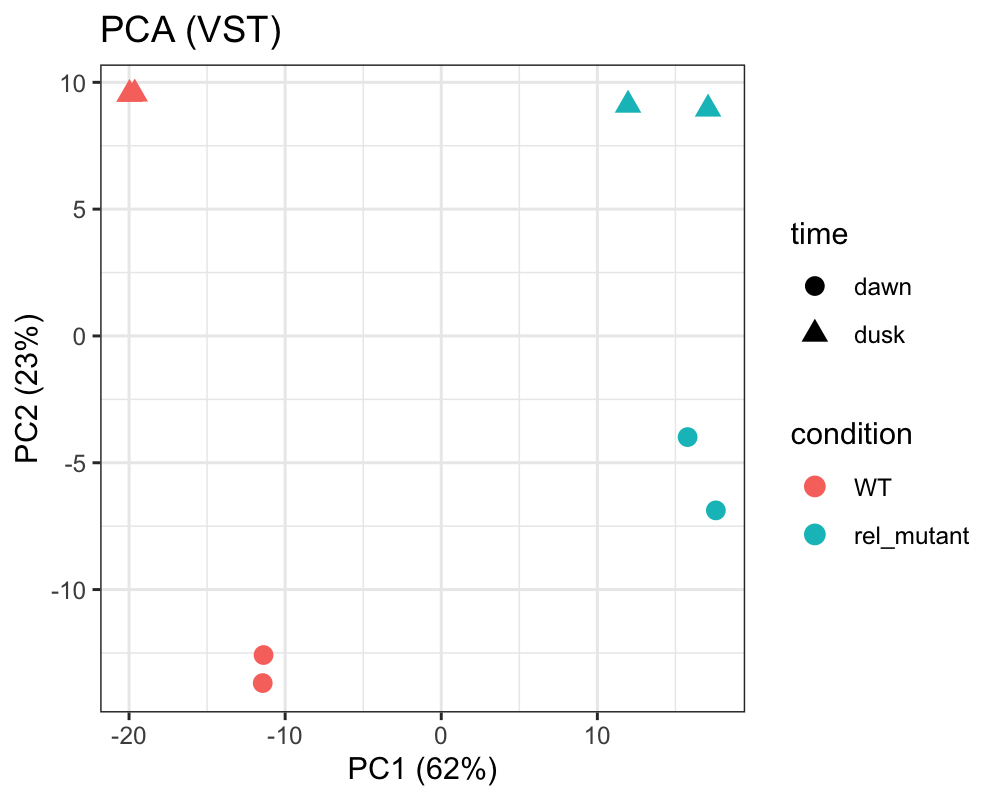
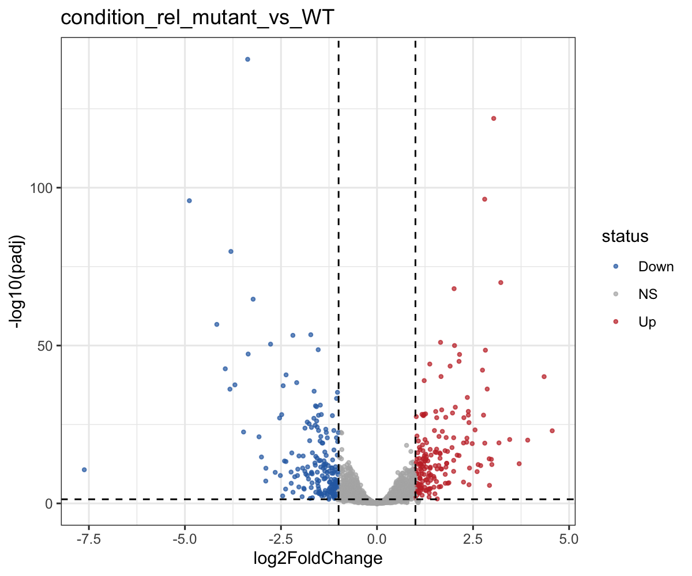

# Synechococcus elongatus PCC 7942 RNA-seq 재분석

공개 RNA-seq 원본 데이터(FASTQ)를 내려받아 **QC → 트리밍 → 참조 게놈 정렬 → 유전자 정량 → 차등발현 분석**까지 직접 수행하고, 원 연구의 결론을 재현할 수 있는지 검증하는 프로젝트.

## 요약

- 공개 RNA-seq 원본 데이터 8샘플(약 1.2억 리드)을 FASTQ부터 직접 처리하는 재현 가능한 파이프라인을 구축 (Bash + Python + R)
- QC(fastp/FastQC) → 정렬(bowtie2, 정렬률 90~95%) → 정량(featureCounts) → 차등발현(DESeq2)
- 가닥 특이성을 할당률 비교로 판별(reverse-stranded)하고, 시점(dawn/dusk)을 공변량으로 보정한 설계로 **368개 차등발현 유전자** 도출
- 결손 유전자(*rel*)의 발현 소실을 **양성 대조**로 확인하고, 다운샘플·전체 리드 결과 간 재현성(log2FC r = 0.91) 검증

## 데이터

| 항목 | 내용 |
|---|---|
| 데이터셋 | GEO **GSE103462** (BioProject PRJNA401742) |
| 생물종 | *Synechococcus elongatus* PCC 7942 (시아노박테리아) |
| 비교 | 야생형(WT) vs *rel*⁻ 변이주 × 시점(dawn / dusk) × 반복 2 = 8샘플, single-end |
| 분석식 | DESeq2 `~ time + condition` (시점 보정 후 genotype 효과 검정) |
| 원 연구 결론 | ppGpp(Rel이 대사)가 빛·암 조건에서 전역 전사 조절에 필요 |
| 참조 게놈 | RefSeq GCF_000012525.1 (염색체 NC_007604.1 + 플라스미드 NC_007595.1) |

## 파이프라인

```
FASTQ (ENA / NCBI SRA) ─ seqtk(선택: 서브샘플) ─ FastQC ─ fastp ─ FastQC ─ MultiQC
      └─ bowtie2 → samtools(sort/index/flagstat) → featureCounts(locus_tag)
            └─ DESeq2 (apeglm shrinkage) → PCA / MA / volcano / heatmap → KEGG 농축(선택)
```

- 세균은 인트론이 없어 스플라이싱 인지 정렬기(HISAT2/STAR) 대신 **bowtie2**를 사용.
- single/paired-end는 스크립트가 파일명으로 자동 판별.

## 실행

```bash
conda env create -f environment.yml
conda activate synecho-rnaseq

bash run_all.sh                     # 1회차: ENA에서 샘플 목록(runs.tsv, samplesheet.csv) 생성 후 멈춤 → 조건 확인
bash run_all.sh                     # 2회차: 서브샘플(샘플당 200만 리드)로 빠른 1차 분석
bash scripts/07_check_strand.sh     # 가닥 특이성 판별 → config.sh 의 STRAND 자동 기록
SUBSAMPLE_READS=0 bash run_all.sh   # 전체 리드 최종 분석 → results_full/
```

## 결과물 (저장소에 포함된 파일)

| 경로 | 내용 |
|---|---|
| `results_full/qc/multiqc_report.html` | 품질 요약 (FastQC + fastp) |
| `results_full/bam/alignment_summary.tsv` | 샘플별 정렬률 |
| `results/strand_check/strand_check.tsv`, `decision.txt` | 가닥 특이성 판별 근거 |
| `results_full/counts/counts.txt(.summary)` | 유전자 count matrix, 할당 통계 |
| `results_full/deseq2/DE_results.csv` | 전체 차등발현 결과 |
| `results_full/deseq2/DE_significant.csv` | 유의 유전자 (padj<0.05, \|log2FC\|≥1) |
| `results_full/deseq2/{PCA,MA,volcano,heatmap_top40}.png` | 그림 |

원본 FASTQ·BAM은 용량 때문에 제외했으며, 위 실행 방법으로 재생성할 수 있습니다. ENA 다운로드가 느리면 `bash scripts/fetch_sra.sh <SRR...>` 로 NCBI SRA에서 받을 수 있습니다(리드 수를 메타데이터와 대조해 검증).

## 결과 (최종: 전체 리드, featureCounts -s 2) — `results_full/`

| 항목 | 값 |
|---|---|
| 입력 리드 | 1,083만 ~ 1,877만 / 샘플 (ENA read_count와 8개 모두 일치) |
| 트리밍 후 품질 (fastp) | Q30 97.0 ~ 97.5%, 필터 통과 98.6 ~ 99.8% |
| 정렬률 (bowtie2) | 89.9 ~ 95.0% |
| 가닥 특이성 | reverse-stranded: 할당률 -s0 86.0% / -s1 3.2% / -s2 83.3% → `STRAND=2` |
| 유전자 할당률 (featureCounts -s 2) | 80.5 ~ 88.9% |
| PCA | PC1(62%) = genotype(WT vs *rel*⁻), PC2(23%) = 시점(dawn vs dusk). 반복끼리 밀집 |
| 차등발현 (`~ time + condition`) | 검정 2,757개 중 padj<0.05: 1,355개, 그중 \|log2FC\|≥1: **368개 (up 180 / down 188)** |
| 재현성 | 1차(200만 리드 서브샘플, -s 0) 결과와 log2FC 상관 r = 0.91, 1차 유의 유전자 333개 중 276개 재검출 |

### 그림

| PCA | Volcano |
|---|---|
|  |  |

**양성 대조**: *rel*(SYNPCC7942_RS07045, RelA/SpoT family) log2FC −7.6 (padj 2.2e-11). 정규화 count WT 5,475~6,515 vs *rel*⁻ 6~221 → 변이주에서 발현 소실 확인.

**주요 변화 유전자**
- 상향: cytochrome c oxidase 오페론(Synpcc7942_2599–2603: ctaD, 서브유닛 II, heme o synthase, COX15/CtaA), Hsp20 계열 열충격 단백질, ferredoxin–nitrite reductase
- 하향: 반응조절자 RppA(Synpcc7942_B2647), PadR 계열 전사조절자, HD/EAL 도메인 단백질, 다수의 hypothetical protein
- 하향된 유전자 중 hypothetical protein 비율이 높음(43/188) → 기능 미지 유전자가 ppGpp 의존 조절을 많이 받음

**원 연구와의 비교**: 전체 유전자의 약 13%(368/2,757)가 2배 이상 변하고 PCA의 최대 변동축이 genotype → ppGpp가 전역 전사 조절에 필요하다는 원 연구 결론과 방향 일치. (원 논문 유전자 목록과의 직접 대조는 미실시)

## 한계

- 그룹당 반복 2개(시점별)로 통계 검정력에 한계.
- 유전자 ID가 RefSeq 신규 locus_tag(SYNPCC7942_RS…)라 KEGG(`syf`, 구 locus_tag Synpcc7942_…) 농축 분석 전에 GFF의 old_locus_tag로 변환 필요 (경로 농축 분석은 미실시).
- 공개 데이터를 이용한 **in silico 재분석**이며, 시료 처리·라이브러리 제작 등 wet 단계는 수행하지 않음.
